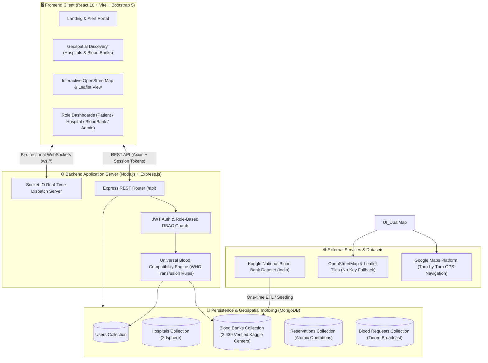
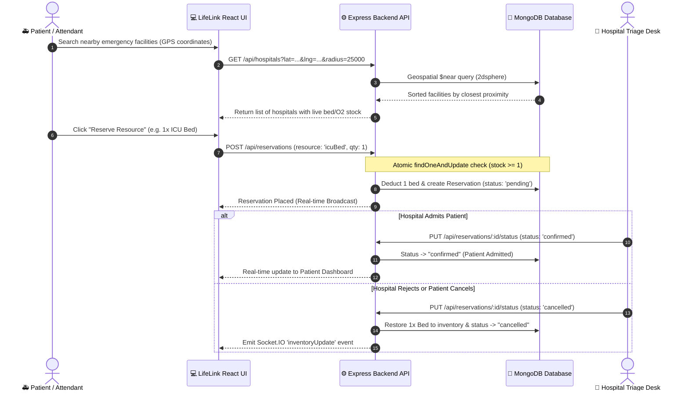
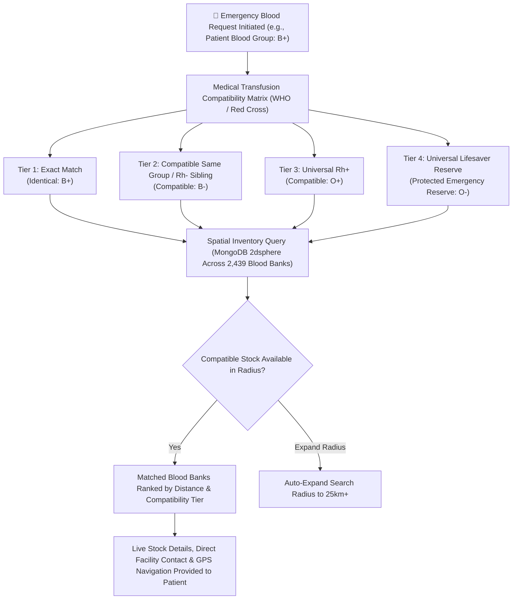

# LifeLink – Emergency Healthcare Resource & Rare Blood Matching Network

[](https://mongodb.com)
[](https://socket.io)
[](https://kaggle.com)
[](https://www.mongodb.com/docs/manual/core/indexes/index-types/index-geospatial/)
[](#-documentation-synchronization)

LifeLink is a centralized, real-time emergency healthcare resource coordination and rare blood matching platform designed to solve the critical "Golden Hour" bottleneck during medical emergencies. It provides instant visibility into life-saving resources (ICU beds, oxygen cylinders, ventilators, and blood units) across India, connecting patients, hospitals, and certified blood banks in real time.

---

## 📑 Table of Contents
1. [System Architecture Flowchart](#-system-architecture-flowchart)
2. [End-to-End Operational Flowcharts](#-end-to-end-operational-flowcharts)
   - [A. Emergency Resource Reservation Workflow](#a-emergency-resource-reservation-workflow)
   - [B. Smart 4-Tier Universal Blood Compatibility Engine](#b-smart-4-tier-universal-blood-compatibility-engine)
3. [Key Features Overview](#-key-features-overview)
4. [Complete Project Directory Structure](#-complete-project-directory-structure)
5. [Database Schemas & Data Models](#-database-schemas--data-models)
6. [REST API Endpoints Reference](#-rest-api-endpoints-reference)
7. [Real-Time WebSocket Events Reference](#-real-time-websocket-events-reference)
8. [Technology Stack](#-technology-stack)
9. [Installation & Quickstart Guide](#-installation--quickstart-guide)
10. [MongoDB Compass Setup & Exploration](#-mongodb-compass-setup--exploration)
11. [Demo Accounts & Role Access Matrix](#-demo-accounts--role-access-matrix)
12. [Documentation Synchronization](#-documentation-synchronization)

---

## 🏛️ System Architecture Flowchart



---

## 🔄 End-to-End Operational Flowcharts

### A. Emergency Resource Reservation Workflow



---

### B. Smart 4-Tier Universal Blood Compatibility Engine



---

## 🌟 Key Features Overview

### 1. 🇮🇳 All-India Official Blood Bank Directory (2,439+ Verified Centers)
- **Kaggle National Registry:** Ingested verified records for **2,439 official blood banks** across India with exact GPS coordinates.
- **Pan-India Coverage:** Spans all **36 States and Union Territories** (Delhi, Maharashtra, Karnataka, Tamil Nadu, West Bengal, Telangana, Gujarat, Rajasthan, Uttar Pradesh, Punjab, Kerala, Bihar, Assam, Odisha, and more).
- **Interactive City Jump Selector:** Jump instantly to any major Indian city/state or use live GPS to find certified blood banks closest to your coordinates.
- **Search by Name/Facility:** Filter by keyword (e.g., *AIIMS*, *Red Cross*, *Rotary*, *Civil Hospital*, *Tata Memorial*) with live distance calculations.
- **Live Inventory by Blood Group:** Real-time unit counts across all 8 blood groups (`A+`, `A-`, `B+`, `B-`, `AB+`, `AB-`, `O+`, `O-`).

### 2. 🧠 Smart Universal Blood Compatibility Engine
- **Medical Transfusion Rules:** Encodes WHO / Red Cross compatibility matrices (e.g., `B+` patients safely receive `B+`, `B-`, `O+`, and `O-`).
- **4-Tier Prioritized Cascading Matching:**
  - **Tier 1:** Exact Match (identical blood group)
  - **Tier 2:** Compatible Same Group / Rh- Sibling
  - **Tier 3:** Universal Rh+ (`O+`)
  - **Tier 4:** Universal Lifesaver Reserve (`O-` protected reserve)
- **Cross-Inventory Blood Bank Matching:** Queries verified blood banks for existing compatible cold storage units within patient radius and displays real-time unit counts, contact details, and directions.

### 3. 🧭 Responsive Cards & Turn-by-Turn Google Maps Navigation
- **Clean Bootstrap 5 Card UI:** Responsive card layout presenting live resource gauges, bed counts, oxygen availability, and blood stock units with zero map bloat.
- **Turn-by-Turn Driving Directions:** Every hospital and blood bank card includes a direct **`🧭 Directions`** button that opens real-time Google Maps GPS driving navigation directly to the facility gate.
- **Indian Standard Time (IST) Support:** All database records and UI views format timestamps in IST (UTC +5:30) for clear local presentation.

### 4. 🏥 Pan-India Official Hospital Directory (10,672+ Verified Centers)
- **National Registry Ingestion:** Ingested the official National Hospital Directory containing **10,672 verified geocoded hospitals** across all 36 States and Union Territories.
- **Direct All-India Directory Access:** Directly browse and search verified hospitals nationwide with live bed counters and oxygen status without radius locks.
- **Pan-India Multi-Filter:** Filter across all 36 States & UTs, search by keyword/city/hospital name, or filter by critical resource need (ICU beds, general emergency beds, oxygen cylinders, ventilators).
- **Critical Resource Standby:** Live tracking of hospital capacity across ICU Beds, Ventilators, General Beds, and Oxygen Cylinders.
- **Dedicated Hospital Portal:** Facility admins update stock in real-time, confirm incoming reservations, and restock beds upon discharge.

### 5. 🔒 Atomic Concurrency & Direct Admission Restock
- **Atomic Operations:** Uses MongoDB atomic updates (`findOneAndUpdate` with conditional checks like `$gte` and `$inc`) to prevent race conditions and double-booking during emergency traffic spikes.
- **Direct Admission & Restock:** Hospital triage desk directly admits incoming patients or cancels/discharges reservations to immediately restock beds in real time.

### 6. 🛡️ System Administration & Facility Verification
- Dedicated Admin dashboard with total network metrics (hospitals, blood banks, reservations).
- Interactive facility verification control to grant or revoke verified badges.

---

## 📁 Complete Project Directory Structure

```text
VitalLink/
├── backend/
│   ├── controllers/
│   │   ├── authController.js           # Registration, login, profile & JWT issuance
│   │   ├── bloodBankController.js      # Blood bank search & inventory management
│   │   ├── bloodRequestController.js   # Emergency compatibility blood bank matching
│   │   ├── hospitalController.js       # Hospital resource tracking & admin verify
│   │   └── reservationController.js    # Atomic holds, admission & restock controller
│   ├── data/
│   │   ├── kaggle_dataset/
│   │   │   └── blood-banks.csv         # Raw national registry from Kaggle
│   │   └── allIndiaBloodBanks.json     # Cleaned 2,439 geocoded blood banks dataset
│   ├── middleware/
│   │   ├── auth.js                     # JWT verification & user injection
│   │   └── roleCheck.js                # Role-based access control (RBAC)
│   ├── models/
│   │   ├── BloodBank.js                # Blood bank model with 2dsphere index
│   │   ├── BloodRequest.js             # Blood broadcast model with matched blood banks
│   │   ├── Hospital.js                 # Hospital resources (ICU, O2, beds, ventilators)
│   │   ├── Reservation.js              # Atomic reservation holds with expiration
│   │   └── User.js                     # Multi-role user accounts (patient, facility, admin)
│   ├── routes/
│   │   ├── auth.js                     # /api/auth routes
│   │   ├── bloodBanks.js               # /api/bloodbanks routes
│   │   ├── bloodRequests.js            # /api/blood-requests routes
│   │   ├── hospitals.js                # /api/hospitals routes
│   │   └── reservations.js             # /api/reservations routes
│   ├── scripts/
│   │   ├── convertKaggleData.js        # ETL script parsing Kaggle CSV into validated JSON
│   │   └── syncReadme.js               # Documentation coverage validator
│   ├── socket/
│   │   └── index.js                    # Socket.IO connection handling & rooms
│   ├── utils/
│   │   └── bloodCompatibility.js       # Transfusion matrix & compatibility tiers
│   ├── .env                            # Backend configuration (PORT, MONGO_URI, JWT_SECRET)
│   ├── package.json                    # Backend dependencies & npm scripts
│   ├── seed.js                         # Database seeder (2,439 blood banks, hospitals, users)
│   └── server.js                       # Express application bootstrap & WebSocket server
│
├── frontend/
│   ├── public/                         # Static assets & icons
│   ├── src/
│   │   ├── components/
│   │   │   ├── BloodBankCard.jsx       # Blood bank card with stock badges & navigation
│   │   │   ├── BloodRequestCard.jsx    # Alert card for emergency blood requests with matched banks
│   │   │   ├── HospitalCard.jsx        # Hospital card with resource gauges & directions
│   │   │   ├── Navbar.jsx              # Responsive navigation header with role badge
│   │   │   ├── PrivateRoute.jsx        # Role-based route guard
│   │   │   └── ReservationModal.jsx    # Modal dialog for booking beds, ICU & oxygen
│   │   ├── context/
│   │   │   ├── AuthContext.jsx         # User auth context backed by sessionStorage
│   │   │   └── SocketContext.jsx       # Global Socket.IO client connection context
│   │   ├── pages/
│   │   │   ├── AdminDashboard.jsx      # Admin metrics & facility verification toggles
│   │   │   ├── BloodBankDashboard.jsx  # Inventory management for blood bank managers
│   │   │   ├── BloodBankDetail.jsx     # Detail view with live blood group inventory
│   │   │   ├── CreateBloodRequest.jsx  # Blood request creator with compatibility preview
│   │   │   ├── Home.jsx                # Landing page with active emergencies & quick links
│   │   │   ├── HospitalDashboard.jsx   # Resource manager for hospital administrators
│   │   │   ├── HospitalDetail.jsx      # Hospital resources (ICU, Beds, O2, Ventilator) & holds
│   │   │   ├── Login.jsx               # One-click demo credentials login page
│   │   │   ├── PatientDashboard.jsx    # Patient holds & active blood request viewer
│   │   │   ├── Register.jsx            # Multi-role registration with GPS detection
│   │   │   ├── SearchBloodBanks.jsx    # All-India blood bank search with city jump & live stock
│   │   │   └── SearchHospitals.jsx     # Hospital discovery with responsive cards & directions
│   │   ├── services/
│   │   │   └── api.js                  # Axios instance with auth token interceptor
│   │   ├── App.jsx                     # Route definitions & application root
│   │   └── main.jsx                    # Vite application entry point
│   ├── package.json                    # Frontend dependencies (React, Vite, Bootstrap)
│   └── vite.config.js                  # Vite build & development server configuration
│
├── package.json                        # Root workspace manager (concurrent scripts)
└── README.md                           # Master project documentation
```

---

## 🗄️ Database Schemas & Data Models

| Model | Collection | Primary Attributes | Key Indexes |
|---|---|---|---|
| **User** | `users` | `name`, `email`, `password`, `phone`, `role` (`patient`, `hospital`, `bloodbank`, `admin`), `bloodGroup`, `location` | `email: 1`, `location: '2dsphere'` |
| **Hospital** | `hospitals` | `name`, `email`, `phone`, `address`, `location`, `resources` (`icuBeds`, `generalBeds`, `oxygenCylinders`, `ventilators`), `verified`, `managedBy` | `location: '2dsphere'`, `verified: 1` |
| **BloodBank** | `bloodbanks` | `name`, `email`, `phone`, `address`, `location`, `inventory` (`bloodGroup`, `unitsAvailable`), `verified`, `managedBy` | `location: '2dsphere'`, `inventory.bloodGroup: 1` |
| **Reservation** | `reservations` | `patient`, `facilityId`, `facilityModel` (`Hospital`), `facilityName`, `resourceType`, `quantity`, `status` (`pending`, `confirmed`, `cancelled`, `completed`) | `patient: 1`, `facilityId: 1`, `status: 1` |
| **BloodRequest** | `bloodrequests` | `patient`, `hospitalName`, `bloodGroup`, `urgency` (`normal`, `critical`), `unitsNeeded`, `status` (`active`, `fulfilled`, `cancelled`), `matchedBloodBanks` (`bloodBank`, `unitsAvailable`, `distanceKm`), `location` | `location: '2dsphere'`, `status: 1` |

---

## 🔌 REST API Endpoints Reference

### Authentication (`/api/auth`)
- `POST /api/auth/register` — Register a new account (`patient`, `hospital`, `bloodbank`).
- `POST /api/auth/login` — Login with credentials and receive a JWT.
- `GET /api/auth/me` — Retrieve current authenticated user profile (`Protected`).

### Hospitals (`/api/hospitals`)
- `GET /api/hospitals` — Discover hospitals nearby via `$near` (`?lat=&lng=&radius=&search=`).
- `GET /api/hospitals/:id` — Retrieve comprehensive hospital resource details.
- `GET /api/hospitals/my` — Get hospital facility managed by logged-in hospital admin (`Hospital/Admin`).
- `POST /api/hospitals` — Create a new hospital facility (`Hospital/Admin`).
- `PUT /api/hospitals/:id/resources` — Update live bed, oxygen, and ventilator stock (`Hospital/Admin`).
- `PUT /api/hospitals/:id/verify` — Toggle verified hospital status (`Admin Only`).

### Blood Banks (`/api/bloodbanks`)
- `GET /api/bloodbanks` — Discover blood banks across India (`?lat=&lng=&radius=&bloodGroup=&search=&limit=`).
- `GET /api/bloodbanks/:id` — Get blood bank facility details and unit inventory.
- `GET /api/bloodbanks/my` — Get blood bank managed by logged-in manager (`BloodBank/Admin`).
- `POST /api/bloodbanks` — Create a new blood bank (`BloodBank/Admin`).
- `PUT /api/bloodbanks/:id/inventory` — Update units available per blood group (`BloodBank/Admin`).
- `PUT /api/bloodbanks/:id/verify` — Toggle verified blood bank status (`Admin Only`).

### Reservations (`/api/reservations`)
- `POST /api/reservations` — Create atomic hospital bed reservation (`Patient`).
- `GET /api/reservations/my` — List all reservations made by the logged-in patient (`Patient`).
- `GET /api/reservations/facility` — List reservations incoming to a hospital (`Facility Admin`).
- `PUT /api/reservations/:id/status` — Mark reservation admitted, cancelled, or discharged (`Facility Admin / Patient`).

### Emergency Blood Requests (`/api/blood-requests`)
- `POST /api/blood-requests` — Broadcast emergency blood need and match nearby verified blood banks holding compatible units (`Patient`).
- `GET /api/blood-requests` — Get emergency blood broadcasts (`Protected`).
- `GET /api/blood-requests/active` — Get all active public emergency blood broadcasts.
- `PUT /api/blood-requests/:id/status` — Update blood request status to fulfilled or cancelled (`Patient/Admin`).

---

## ⚡ Real-Time WebSocket Events Reference

LifeLink uses Socket.IO to provide instant peer-to-peer and broadcast emergency synchronization:

| Event Name | Direction | Payload | Description |
|---|---|---|---|
| `newBloodRequest` | Server $\to$ All Clients | `{ bloodRequest }` | Emitted when an emergency blood broadcast is posted; informs network of urgent blood requirements. |
| `inventoryUpdate` | Server $\to$ All Connected Clients | `{ type: 'hospital'/'bloodbank', facilityId, resources }` | Real-time broadcast whenever bed or blood stock changes or a bed is restocked. |
| `reservationCreated` | Server $\to$ Facility Room | `{ reservationId, facilityId, resourceType, quantity, patientName }` | Alerts hospital triage reception that a critical resource has been reserved. |
| `reservationStatus` | Server $\to$ Patient Room | `{ reservationId, status: 'confirmed'/'cancelled'/'completed' }` | Updates the patient's dashboard in real time when triage marks them admitted or cancelled. |

---

## 🛠️ Technology Stack

| Category | Technologies | Description |
|---|---|---|
| **Frontend Framework** | React 18, Vite | High-performance SPA with fast HMR |
| **Routing & Navigation** | React Router v7 | Nested, role-guarded client routing |
| **UI Components** | Bootstrap 5, React-Bootstrap | Clean, accessible, standardized design |
| **Mapping & Directions** | Google Maps Driving Navigation | Direct GPS turn-by-turn driving directions to facility gate |
| **Backend Runtime** | Node.js, Express.js | Asynchronous RESTful service tier |
| **Real-Time Layer** | Socket.IO Client & Server | Sub-second emergency broadcasts & inventory synchronization |
| **Database & GIS** | MongoDB, Mongoose ODM | Document store with native `2dsphere` geospatial indexing |
| **Security & Sessions** | JWT, bcryptjs, `sessionStorage` | Multi-window independent testing without cookie/token collision |

---

## 🚀 Installation & Quickstart Guide

### Prerequisites
- **Node.js**: v18.0.0 or higher
- **MongoDB Server**: Running locally on `mongodb://localhost:27017` (or remote MongoDB Atlas URI)

### Step 1: Clone and Install Dependencies

```powershell
# In project root:
npm install

# Install backend dependencies:
cd backend
npm install

# Install frontend dependencies:
cd ../frontend
npm install

# Return to root:
cd ..
```

### Step 2: Configure Environment Variables

Verify that `backend/.env` exists and contains:
```env
PORT=5000
MONGO_URI=mongodb://localhost:27017/lifelink
JWT_SECRET=lifelink_super_secret_jwt_key_2026
```

### Step 3: Seed Database with 2,439 Verified Blood Banks

```powershell
# Run the database seeder from root:
npm run seed
```
*This populates all 2,439 verified Indian blood banks, 3 sample emergency hospitals, voluntary donation drives, and pre-configured demo user accounts.*

### Step 4: Start the Application

You can start both backend and frontend concurrently with a single command:

```powershell
# From root directory:
npm run dev
```

Or start them individually in separate terminal windows:
```powershell
# Terminal 1 - Backend API (Port 5000):
npm run server

# Terminal 2 - React Frontend (Port 5173 / 3000):
npm run client
```

Open **[http://localhost:5173](http://localhost:5173)** in your browser.

---

## 🧭 MongoDB Compass Setup & Exploration

1. Open **MongoDB Compass**.
2. Connect to the local instance using:
   ```text
   mongodb://localhost:27017
   ```
3. In the sidebar, select the **`lifelink`** database.
4. Explore the collections:
   - `bloodbanks`: 2,439 verified centers with live stock and GPS coordinates.
   - `hospitals`: Emergency facilities with ICU, oxygen, and ventilator reserves.
   - `reservations`: Atomic holds and fast-track admission records.

#### Useful Compass Filter Queries:
- **Search by City or State:**
  ```json
  { "address": { "$regex": "Mumbai", "$options": "i" } }
  ```
- **Find Rare O- Blood Stock:**
  ```json
  { "inventory": { "$elemMatch": { "bloodGroup": "O-", "unitsAvailable": { "$gt": 5 } } } }
  ```
- **Find Certified Red Cross Centers:**
  ```json
  { "name": { "$regex": "Red Cross", "$options": "i" } }
  ```

---

## 🔑 Demo Accounts & Role Access Matrix

All pre-seeded demo accounts use the standard password: **`password123`**

| Role | Email | Password | Primary Capabilities |
|---|---|---|---|
| **National Admin** | `admin@lifelink.org` | `password123` | System overview, verify/revoke facilities |
| **Hospital Admin** | `hospital@apollo.com` | `password123` | Live ICU beds, oxygen, and ventilator stock management; admit incoming patients |
| **Blood Bank Admin** | `bloodbank@city.org` | `password123` | Manage units for all 8 blood groups; stock inventory monitoring |
| **Patient / Attendant** | `patient@example.com` | `password123` | Discover facilities, reserve beds/ICU, broadcast emergency blood requests to blood banks |

> [!TIP]
> LifeLink uses `sessionStorage` for auth tokens. You can open multiple private/incognito windows or tabs to test simultaneous real-time interactions between a **Patient** and a **Hospital Admin** or **Blood Bank Admin** at the same time!

---

## 👥 Contributors & Core Team

| Name / GitHub | Role & Department | Core Ownership |
|---|---|---|
| **[Charudatta Patil](https://github.com/CharudattaPatil-AC)** | **Project Lead & Backend / Real-Time Systems Lead** | Server architecture, atomic concurrency engine, bed admission & restock workflow, and WebSocket rooms |
| **Team Member 2** | **Data Engineering & Clinical Algorithms Lead** | Kaggle 2,439 blood banks dataset ingestion, MongoDB `2dsphere` spatial indexing, 4-tier WHO compatibility engine, and scarcity analytics |
| **Team Member 3** | **Frontend Architecture & GIS / Document Lead** | React 18 SPA, dual map engine (Leaflet + Google Maps), QR fast-track pass, client-side vector PDF generator, and donation drives |

---

## 🔄 Documentation Synchronization

To ensure documentation integrity, run the automated codebase audit tool whenever changes are made:

```powershell
npm run doc:sync
```

This verifies that all backend routes, Mongoose models, frontend pages, UI components, and dependencies match `README.md` with 100% coverage.
